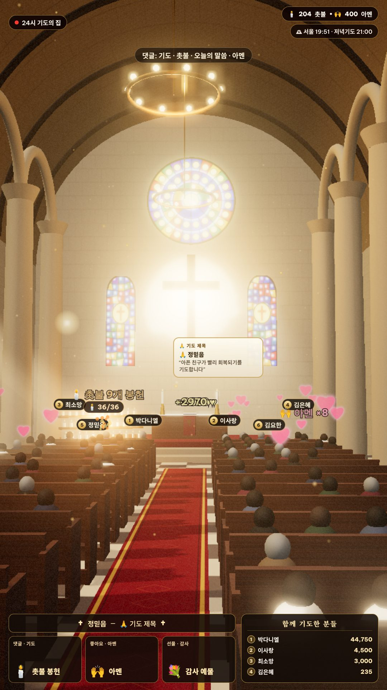
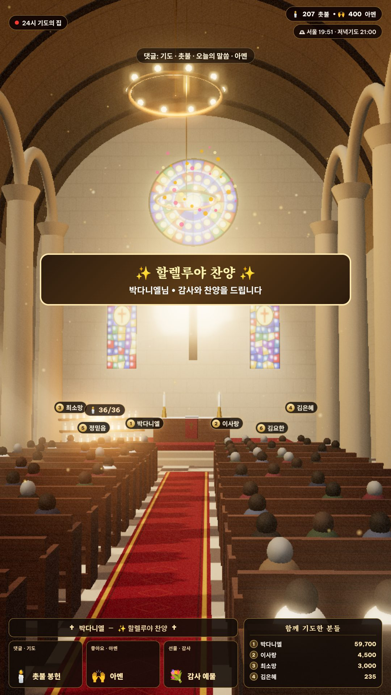
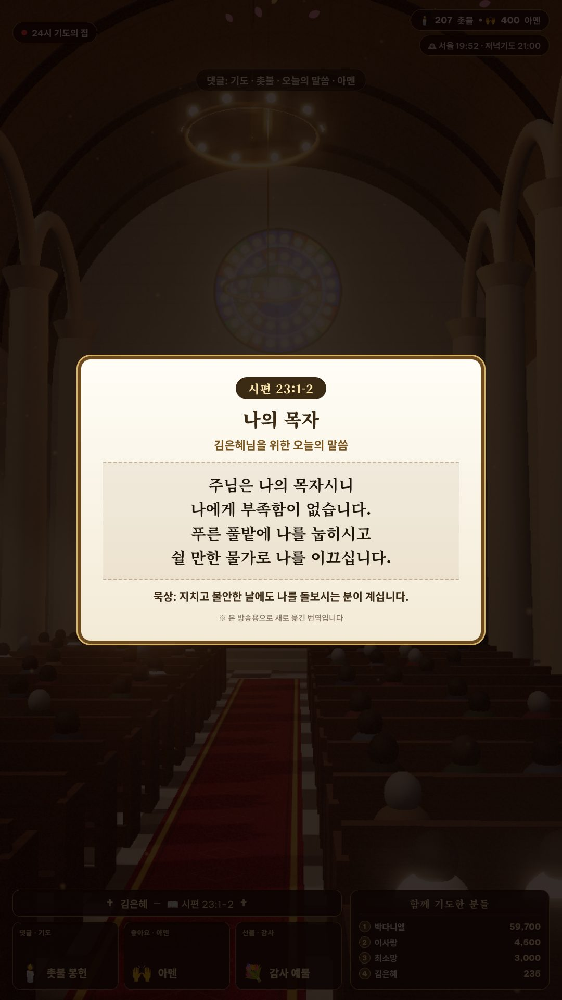
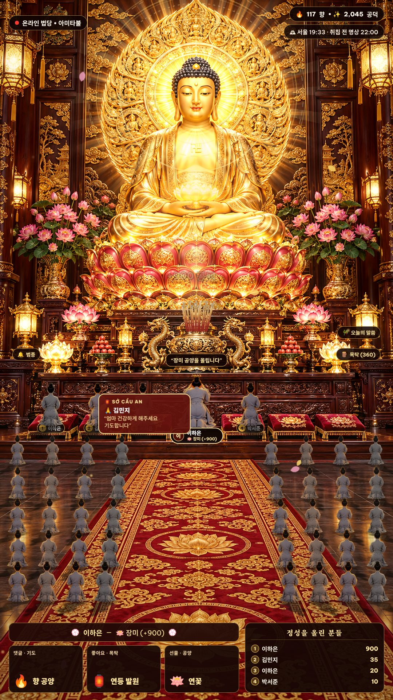

# 🇰🇷 Phát TikTok Live 24/7 cho người xem Hàn Quốc

Tài liệu này hướng dẫn chạy **2 phòng tiếng Hàn** (Chùa và Nhà thờ 3D) song song với phòng Chùa tiếng Việt cũ.

> Ghi chú thuật ngữ: *TTS* = máy đọc chữ thành giọng nói; *OBS* = phần mềm phát trực tiếp miễn phí; *PM2* = công cụ giữ chương trình chạy liên tục; *KST* = giờ Hàn Quốc (UTC+9, sớm hơn Việt Nam 2 tiếng); *WebGL / Three.js* = công nghệ vẽ 3D trong trình duyệt bằng card màn hình.

---

## 1. Vì sao chọn Chùa và Nhà thờ?

Theo khảo sát **Gallup Korea** công bố năm 2026 (số liệu năm 2025):

| Tôn giáo | Tỷ lệ dân số |
| :--- | :---: |
| Không theo tôn giáo | ~60% |
| **Tin Lành** (개신교) | ~18% — đông nhất |
| **Phật giáo** (불교) | ~16% |
| **Công giáo** (천주교) | ~6% (khảo sát khác cho ~11%) |

⇒ Tin Lành và Phật giáo là hai nhóm lớn nhất, gần ngang nhau. Vì vậy dự án có:
- **Phòng Chùa tiếng Hàn** (`temple.ko`): dùng lại cảnh Chánh Điện 3D có sẵn, đổi toàn bộ chữ và giọng sang tiếng Hàn.
- **Phòng Nhà thờ tiếng Hàn** (`church.ko`) — "24시 기도의 집" (*Nhà cầu nguyện 24 giờ*): dựng mới hoàn toàn bằng 3D thật. Lời lẽ dùng chung được cho cả Tin Lành lẫn Công giáo.

Lưu ý: người trẻ Hàn Quốc ít theo đạo (theo Gallup Korea, chỉ ~24% người 20–29 tuổi có tôn giáo). Khán giả chính có thể là người trung niên trở lên.

---

## 2. Ba phòng hiện có

| Gói (`PACK`) | Phòng | Ngôn ngữ trên màn hình & giọng đọc | Hình ảnh |
| :--- | :--- | :--- | :--- |
| `temple.vi` | Chùa Linh Ứng (bản gốc) | Tiếng Việt — giọng ZeroTTS **Mai Chi** (chạy không cần mạng) | Ảnh Chánh Điện + hiệu ứng chiều sâu |
| `temple.ko` | 온라인 법당 (Chùa trực tuyến) | Tiếng Hàn — giọng nữ **SunHi** của Microsoft (cần Internet) | Như trên |
| `church.ko` | 24시 기도의 집 (Nhà cầu nguyện 24 giờ) | Tiếng Hàn — giọng **SunHi** | **Cảnh 3D thật** dựng bằng Three.js |



*Nhà thờ 3D: hàng ghế gỗ có người ngồi, vòm trần, cửa kính màu, cửa sổ hoa hồng, thập tự phát sáng, giá nến dâng (36 ngọn sáng dần theo số người thắp), thẻ tên 6 người ủng hộ nhiều nhất ngồi hàng đầu, trái tim "Amen" bay lên.*

| Quà lớn — "할렐루야 찬양" (Hallelujah) | Câu Kinh Thánh hôm nay | Chùa tiếng Hàn |
| :---: | :---: | :---: |
|  |  |  |

---

## 3. Người xem làm gì → màn hình phản ứng ra sao

### Phòng Nhà thờ (`church.ko`)

| Người xem làm | Từ khoá trong bình luận (tiếng Hàn — nghĩa) | Trên màn hình |
| :--- | :--- | :--- |
| Bình luận | `기도` (cầu nguyện), `주님` (Chúa), `하나님` (Thiên Chúa), `축복` (chúc phúc), `감사` (cảm ơn), `건강` (sức khoẻ)… | Thẻ **"기도 제목"** (ý cầu nguyện) bay lên + quả cầu ánh sáng bay tới thập tự + giọng đọc lời cầu nguyện |
| Bình luận | `촛불` (nến), `봉헌` (dâng) | Thắp nến trên giá nến |
| Bình luận | `오늘의 말씀` / `말씀` / `성경` (lời Chúa / Kinh Thánh) | Thẻ **câu Kinh Thánh** hiện ra đúng lúc giọng đọc bắt đầu |
| Bình luận | `아멘` (Amen), `할렐루야` | Trái tim bay lên |
| Bình luận | `종소리` (tiếng chuông) | Chuông nhà thờ + hào quang thập tự |
| Thả tim (like) | — | "Amen" + trái tim |
| Theo dõi (follow) | — | Giọng đọc: "*A님, B님 외 2분, 팔로우해 주셔서 감사합니다*" (cảm ơn A, B và 2 người khác đã theo dõi) |
| Tặng quà nhỏ | — | Đọc lời cảm ơn, bừng sáng, lên bảng xếp hạng |
| Tặng quà ≥ 100 xu | — | Băng rôn **"할렐루야 찬양"** + hợp âm + mưa ánh sáng vàng |

### Phòng Chùa tiếng Hàn (`temple.ko`)

| Từ khoá (nghĩa) | Nghi thức |
| :--- | :--- |
| `오늘의 말씀`, `법문`, `부처님 말씀` (lời Phật dạy) | Thẻ **"Lời Phật dạy hôm nay"** trích **Kinh Pháp Cú** (법구경). Xin xăm kiểu Trung Hoa không phổ biến ở chùa Hàn nên được thay bằng thẻ này. |
| `기도`, `발원`, `소원` (cầu nguyện, phát nguyện, điều ước), `나무아미타불` | Thả đèn **연등** (đèn hoa sen — đặc trưng Phật giáo Hàn) |
| `향 올`, `분향`, `참배`, `합장` (dâng hương, lễ bái, chắp tay) | Dâng hương |
| `범종`, `타종` (đại hồng chung) | Thỉnh chuông |
| `목탁`, `염불` (mõ, niệm Phật) | Gõ mõ |

**Bộ lọc**: tự chặn chửi tục tiếng Hàn (cả dạng viết tắt như `ㅅㅂ`, `ㅂㅅ`), quảng cáo lừa đảo (`텔레그램`, `리딩방`…), và bình luận chỉ có `ㅋㅋㅋ` (cười) hoặc `ㅠㅠ` (khóc), vì đọc lên rất khó nghe.

---

## 4. Tính năng chạy 24/7

| Tính năng | Chi tiết |
| :--- | :--- |
| **Lịch lễ theo giờ Hàn** (KST) | Chùa: 04:00 lễ khuya (새벽예불), 10:00 lễ trưa (사시불공), 18:00 lễ chiều (저녁예불), 22:00 thiền trước khi ngủ.<br>Nhà thờ: 05:00 cầu nguyện rạng sáng (새벽기도, nét đặc trưng của Hội thánh Hàn Quốc), 12:00 cầu nguyện trưa, 21:00 cầu nguyện tối, **Chủ nhật** 11:00 giờ thờ phượng.<br>Đến giờ: chuông ngân, băng rôn và giọng đọc thông báo. Giờ tính theo **Seoul**, dù máy đặt ở Việt Nam hay ở đâu. |
| **Đồng hồ Seoul** | Góc trên bên phải hiện giờ Seoul và buổi lễ kế tiếp. |
| **Tự đọc khi phòng vắng** | Không ai tương tác trong `IDLE_TALK_MINUTES` phút (mặc định 5), hệ thống tự đọc một câu Kinh Thánh / lời Phật dạy hoặc lời mời bình luận. Màn hình không bao giờ "đứng im" quá lâu. |
| **Không dùng người xem giả** | Lời tự đọc và thông báo giờ lễ là lời của chủ phòng, không gắn tên người xem giả. Chế độ "Giả lập người xem" chỉ để **thử nghiệm**, **đừng bật khi phát thật**: người xem sẽ tưởng có người thật đang tặng quà, dễ vi phạm quy định TikTok. |
| **Giọng đọc dự phòng** | Mất mạng, không tạo được giọng Microsoft ⇒ trang tự dùng giọng tiếng Hàn của Windows (nếu đã cài gói ngôn ngữ Hàn). |
| Các tính năng cũ | Tự kết nối lại TikTok, tự khởi động lại giọng đọc, tự dọn bộ nhớ đệm, `/healthz`, tự tải lại trang OBS… (xem [LIVE-24-7.md](LIVE-24-7.md)). |

---

## 5. Cài đặt và chạy

### Bước 1 — Giọng đọc tiếng Hàn (một lần)
```bash
npm install
npm run setup:tts-ko        # = tạo .venv rồi pip install edge-tts
```
Trên Windows (lệnh `npm run setup:tts-ko` dùng đường dẫn kiểu Linux), chạy thay bằng:
```bash
python -m venv .venv
.venv\Scripts\pip install edge-tts
```
Máy chủ tự tìm Python ở cả `.venv/bin/python` (Linux/macOS) và `.venv\Scripts\python.exe` (Windows).

### Bước 2 — Chạy thử từng phòng
```bash
npm run start:church-ko     # Nhà thờ  → http://localhost:3002
npm run start:temple-ko     # Chùa Hàn → http://localhost:3001
npm run start:node          # Chùa Việt → http://localhost:3000
```
Mở địa chỉ trên bằng Chrome. Bảng điều khiển bên phải (tiếng Việt) có các nút thử từng nghi thức, **thử giờ lễ** và **thử đọc khi vắng**. Bấm một lần vào trang để trình duyệt cho phép phát âm thanh.

### Bước 3 — Chạy 24/7 bằng PM2
Mở `ecosystem.config.cjs`, sửa `TIKTOK_USER` của từng phòng, rồi chạy:
```bash
npm i -g pm2
pm2 start ecosystem.config.cjs --only church-ko,temple-ko
pm2 save && pm2 startup
```

### Biến môi trường mới

| Biến | Mặc định | Ý nghĩa |
| :--- | :---: | :--- |
| `PACK` | `temple.vi` | Chọn phòng: `temple.vi`, `temple.ko`, `church.ko` (hoặc dùng `ROOM=church` + `LOCALE=ko`). |
| `IDLE_TALK_MINUTES` | `5` | Số phút vắng trước khi tự đọc. `0` = tắt. |
| `TTS_ENGINE` | theo phòng | `edge` (giọng Microsoft) hoặc `zerotts` (Mai Chi). |
| `TTS_VOICE` | `ko-KR-SunHiNeural` | Đổi giọng, ví dụ giọng nam `ko-KR-InJoonNeural`. |
| `EDGE_TTS_RATE` | `-5%` | Tốc độ đọc (âm = chậm hơn). |
| `ROOM_TZ` | `Asia/Seoul` | Múi giờ dùng cho lịch lễ. |

---

## 5B. Giọng nữ cao cấp qua Vibi (vibi.pro) — tuỳ chọn, trả phí

[Vibi](https://vibi.pro) bán lại giọng của **ElevenLabs**, **MiniMax** và **CapCut** qua một API chung. Giọng ElevenLabs/MiniMax tự nhiên và có cảm xúc hơn hẳn giọng Microsoft miễn phí.

| Nhà cung cấp | Tiếng Hàn | Tiếng Việt | Ghi chú |
| :--- | :---: | :---: | :--- |
| ElevenLabs | ✅ | ✅ | Thư viện giọng cộng đồng rất lớn, lọc theo giới tính / tuổi / ngôn ngữ |
| MiniMax | ✅ | ✅ | Có giọng hệ thống tiếng Hàn |
| CapCut | ❌ | ✅ | Giọng quen thuộc trên TikTok Việt; **không có tiếng Hàn** |

### Bước 1 — Lấy khoá API
Đăng nhập vibi.pro → **Tài liệu API** (*API Docs*) → sao chép **API Key**. **Đừng** dán khoá vào file nào rồi đẩy lên GitHub.

### Bước 2 — Tìm giọng nữ hay và nghe thử
```bash
# Linux/macOS
export VIBI_API_KEY=khoá_của_bạn
node tools/vibi-voices.js --lang ko --gender female      # giọng nữ tiếng Hàn
node tools/vibi-voices.js --lang vi --gender female      # giọng nữ tiếng Việt
# Windows (cmd):  set VIBI_API_KEY=khoá_của_bạn   rồi chạy lệnh node như trên
```
Lệnh in bảng giọng (ElevenLabs xếp theo lượt được dùng lại — càng cao càng được ưa chuộng) và tạo trang **`data/vibi-voices.html`**: mở bằng trình duyệt, bấm ▶ nghe thử từng giọng, cột cuối có sẵn dòng cấu hình.

Nghe thử chính câu sẽ phát trên live (tốn vài credit):
```bash
node tools/vibi-voices.js --say "김은혜님, 촛불을 밝혀 주셔서 감사합니다." --voice <voice_id> --provider elevenlabs
```
→ file `data/vibi-sample-....mp3`.

### Bước 3 — Bật cho phòng
```bash
export VIBI_API_KEY=khoá_của_bạn
export VIBI_VOICE_ID=<voice_id đã chọn>
export VIBI_PROVIDER=elevenlabs        # hoặc minimax
pm2 start ecosystem.config.cjs --only church-ko,temple-ko --update-env
```
Hoặc chạy thử 1 phòng: `TTS_ENGINE=vibi VIBI_API_KEY=... VIBI_VOICE_ID=... npm run start:church-ko`.

### An toàn chi phí khi chạy 24/7
- Mỗi câu đọc **tốn credit theo số ký tự**. Câu đã đọc được lưu đệm, đọc lại không tốn thêm.
- `VIBI_DAILY_CHAR_LIMIT` (mặc định **30.000 ký tự/ngày**): vượt hạn mức, **hết credit**, sai khoá hoặc Vibi lỗi ⇒ **tự chuyển sang giọng Microsoft miễn phí** (cần đã cài `edge-tts`), live không bị câm.
- Số ký tự đã dùng hôm nay: `data/vibi-usage.json`.
- Tham khảo: một phòng đông tương tác có thể đọc 300–600 câu/giờ (~50 ký tự/câu) ⇒ 15.000–30.000 ký tự/giờ. Đặt hạn mức theo ngân sách của bạn.

| Biến | Mặc định | Ý nghĩa |
| :--- | :---: | :--- |
| `TTS_ENGINE=vibi` | — | Bật Vibi (PM2 tự bật khi có `VIBI_API_KEY` + `VIBI_VOICE_ID`) |
| `VIBI_PROVIDER` | `elevenlabs` | `elevenlabs` / `minimax` / `capcut` |
| `VIBI_LANGUAGE` | `ko` | ElevenLabs/CapCut: `ko`, `vi`. MiniMax: `Korean`, `Vietnamese` |
| `VIBI_SPEED` | `1.0` | Tốc độ đọc |
| `VIBI_STABILITY` / `VIBI_SIMILARITY` | `0.5` / `0.75` | [ElevenLabs] độ ổn định / độ giống giọng gốc |
| `VIBI_DAILY_CHAR_LIMIT` | `30000` | Hạn mức ký tự mỗi ngày (`0` = không giới hạn) |

> Lưu ý bản quyền giọng: giọng trong thư viện cộng đồng ElevenLabs do người khác tạo; một số giọng có điều khoản riêng. Hãy đọc điều khoản sử dụng thương mại của Vibi / ElevenLabs trước khi phát kiếm tiền.

---

## 6. OBS cho phòng Nhà thờ 3D

- Nguồn trình duyệt (*Browser Source*): `http://localhost:3002/?obs=1`, kích thước `1080 × 1920`, 30 khung hình/giây (*FPS*).
- **Bắt buộc** bật *Enable Browser Source Hardware Acceleration* (dùng card màn hình). Cảnh 3D cần GPU.
- Máy yếu: `?obs=1&q=0.75&shadows=0`. Máy rất yếu / máy chủ ảo không GPU: `?obs=1&fx3d=0` (nền tĩnh, hiệu ứng 2D vẫn chạy).

| Tham số | Mặc định | Ý nghĩa |
| :--- | :---: | :--- |
| `q` | `1` | Độ phân giải 3D (`0.4`–`1`). |
| `shadows` | `1` | `0` = tắt bóng đổ (nhẹ hơn nhiều). |
| `bloom` | `0.62` | Độ toả sáng quanh đèn, nến, kính màu (`0`–`2`). |
| `fps` | `30` | Số khung hình/giây của cảnh 3D. |
| `fx3d` | bật | `0` = tắt 3D. |
| `camt` | — | Đóng băng camera tại giây thứ N (chỉ dùng để chụp ảnh). |

Các cấu hình OBS khác (bitrate, tự kết nối lại…) giống [LIVE-24-7.md](LIVE-24-7.md#3-cấu-hình-obs-để-phát-247).

**Nhạc nền**: đặt file nhạc bạn **có quyền sử dụng** vào `public/assets/bg_church.m4a` (Nhà thờ) hoặc `public/assets/bg_chant.m4a` (Chùa). Không có file thì Nhà thờ tự phát hợp âm đàn organ tổng hợp, Chùa phát chuông thiền.

---

## 7. ⚠️ Cần biết trước khi phát ở Hàn Quốc

1. **Tuổi và điều kiện TikTok LIVE ở Hàn**: theo nhiều trang hướng dẫn (không phải trang chính thức của TikTok), người phát LIVE phải **từ 18 tuổi**, và ở Hàn **gửi/nhận quà cần từ 19 tuổi** (các nước khác là 18). Thường cần khoảng **1.000 người theo dõi**, con số này có thể khác theo khu vực. Hãy kiểm tra Trung tâm trợ giúp (*Help Center*) của TikTok trước khi đầu tư.
2. **Phát liên tục không người**: TikTok có thể hạn chế phòng LIVE bị coi là nội dung lặp lại / ghi sẵn. Hệ thống phản ứng theo bình luận thật, có lịch lễ và lời tự đọc thay đổi, nhưng không có gì bảo đảm TikTok sẽ không hạn chế. Hãy đọc Nguyên tắc cộng đồng hiện hành.
3. **Nội dung tôn giáo**: lời đọc được viết theo hướng *cảm ơn và cầu nguyện cùng*, **không hứa hẹn "tặng quà sẽ được phù hộ"**. Nên giữ nguyên tinh thần này để tránh bị báo cáo và tôn trọng người xem.
4. **Câu Kinh Thánh**: bản tiếng Hàn trong dự án do **dự án tự dịch** từ nguyên bản (đã thuộc phạm vi công cộng). Dự án **không** chép bản 개역개정 hay 새번역, vốn thuộc bản quyền của Hội Kinh Thánh Hàn Quốc. Còn bản cũ 개역한글 (1961) thì các nguồn chưa thống nhất là đã hết bản quyền hay chưa. Thẻ có ghi chú "본 방송용으로 새로 옮긴 번역입니다" (bản dịch mới dành cho buổi phát này). Nếu muốn dùng bản dịch chính thức, cần xin phép Hội Kinh Thánh Hàn Quốc.
5. **Kinh Pháp Cú**: bản tiếng Hàn cũng do dự án tự dịch từ nguyên bản Pāli cổ.
6. **Giọng đọc edge-tts**: dùng dịch vụ đọc trực tuyến của Microsoft qua thư viện mã nguồn mở `edge-tts`. Đây **không phải** dịch vụ trả phí chính thức, nên Microsoft có thể thay đổi hoặc chặn bất cứ lúc nào. Khi đó hệ thống tự dùng giọng tiếng Hàn của Windows. Muốn ổn định lâu dài cho việc kinh doanh, nên chuyển sang dịch vụ trả phí chính thức (Azure Speech, Google Cloud TTS, Naver Clova Voice).
7. **Hình ảnh Chùa** kế thừa từ dự án gốc `zane-tv/tiktok-live-temple-rpc`. **Cảnh Nhà thờ** được vẽ hoàn toàn bằng mã, không dùng ảnh của ai.

---

## 8. Muốn thêm phòng / ngôn ngữ khác?

Mỗi phòng là một file trong `lib/packs/`, ví dụ `church.ko.js`. File gồm câu đọc, từ khoá bình luận, bộ thẻ (quẻ / câu Kinh Thánh), lịch lễ và chữ trên màn hình. Cách làm:
1. Sao chép file gần giống nhất.
2. Dịch lại nội dung.
3. Thêm 1 dòng vào `lib/packs/index.js`.
4. Chạy `npm test`: bộ kiểm thử tự kiểm tra gói mới có đủ trường bắt buộc và đúng định dạng giờ.
