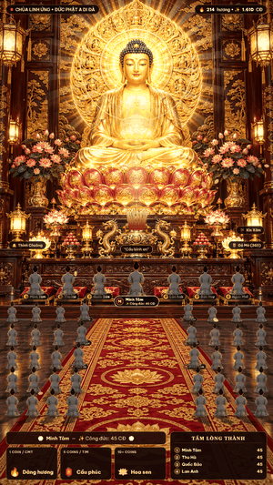

# 🪷 Hướng dẫn phát TikTok Live 24/7 với hình ảnh 3D chân thực

Tài liệu này giải thích **chế độ 3D chân thực** mới và cách vận hành hệ thống **liên tục 24 giờ/ngày, 7 ngày/tuần**.

> Ghi chú thuật ngữ: *WebGL* = công nghệ vẽ đồ họa 3D bằng card màn hình ngay trong trình duyệt; *OBS* = phần mềm phát trực tiếp miễn phí; *Browser Source* = nguồn "trình duyệt" trong OBS; *FPS* = số khung hình mỗi giây; *bitrate* = lưu lượng dữ liệu video mỗi giây.

---

## 1. Chế độ 3D chân thực hoạt động thế nào?



*Ảnh động trên đã được **tua nhanh khoảng 18 lần** để dễ quan sát. Khi phát thật, camera trôi rất chậm (chu kỳ 40–50 giây), người xem chỉ cảm nhận được không gian có chiều sâu.*

| Thành phần | Trước đây | Bây giờ |
| :--- | :--- | :--- |
| **Nền Chánh Điện** | Ảnh tĩnh phẳng | WebGL + **bản đồ chiều sâu** (depth map): camera ảo trôi nhẹ, vật ở gần dịch nhiều hơn vật ở xa ⇒ mắt cảm nhận chiều sâu 3D thật (gọi là *thị sai chuyển động*). |
| **Ánh sáng** | Không có | **Bloom** (quầng sáng quanh đèn, hào quang), **đèn lồng lập lòe** như ánh nến, **tia sáng thể tích** (god rays) tỏa từ hào quang Đức Phật, chỉnh màu điện ảnh, tối dần 4 góc (vignette). Thỉnh chuông / Đại Lễ ⇒ hào quang bùng sáng. |
| **Phật tử** | Hình dán tông xanh lạnh, viền vàng đều, bóng đen dính sẵn | Chỉnh màu theo ánh nến ấm, **ánh sáng ngược** (rim light) tập trung ở đầu và vai, bỏ bóng giả, làm mềm mép cắt. |
| **Bám sàn** | Lơ lửng | **Bóng đổ hình chiếu** hắt về phía người xem (vì nguồn sáng là bàn thờ ở phía trước họ), nghiêng theo vị trí trái/phải; **phản chiếu mờ** trên sàn đá bóng; bóng tiếp xúc dưới gối. |
| **Sống động** | 40 người giống hệt, đứng im | Nhịp thở nhẹ, mỗi người một màu áo (lam / nâu / xám tro) và hướng quay khác nhau, hàng xa mờ hơn như có khói hương (phối cảnh không khí). |
| **Đồng bộ** | — | Mỗi lớp HTML (hàng ghế, đệm VIP, lư hương, chủ lễ đang đi) được gắn vào **cùng camera 3D** theo chiều sâu, nên nhân vật dịch **khớp** với sàn nền. |

### Đã kiểm chứng
- **Độ khớp nền ↔ nhân vật**: đo bằng tương quan ảnh giữa 2 vị trí camera. Ví dụ tại điểm (250, 1645): nền dịch (−21, +11) px, lớp hàng ghế dịch (−21,8; +11,3) px ⇒ sai lệch **< 1 px**. Bàn thờ (mặt phẳng hội tụ) dịch 0 px như thiết kế.
- **Dự phòng**: máy không có WebGL hoặc card màn hình bị reset ⇒ tự hiện lại ảnh tĩnh gốc, livestream không bị đen màn hình.

### Tham số trên đường dẫn (URL)

| Tham số | Mặc định | Ý nghĩa |
| :--- | :---: | :--- |
| `?obs=1` | — | Màn hình sạch cho OBS (đã có từ trước). |
| `&fx3d=0` | bật | Tắt hoàn toàn 3D, quay về ảnh tĩnh (dùng cho máy rất yếu). |
| `&depth=1` | `1` | Độ mạnh chuyển động 3D, từ `0` đến `2`. Khuyên dùng `0.8`–`1.2`. |
| `&light=1` | `1` | Độ mạnh ánh sáng (bloom + tia sáng), từ `0` đến `2`. |
| `&q=1` | `1` | Độ phân giải WebGL (`0.4`–`1`). Máy yếu dùng `0.75`. |
| `&fps=30` | `30` | Số khung hình/giây của nền 3D. |
| `&reload=12` | `12` (khi `obs=1`) | Tự tải lại trang sau N giờ (lúc đang yên tĩnh) để giải phóng bộ nhớ. `0` = tắt. |
| `&camt=10` | — | Đóng băng camera tại giây thứ 10 — chỉ dùng để chụp ảnh kiểm tra. |

Ví dụ đường dẫn cho OBS: `http://localhost:3000/?obs=1&depth=1&light=1`

### Muốn thay ảnh nền / nhân vật khác?
Ảnh 3D được sinh tự động bằng công cụ:
```bash
uv pip install --python .venv/bin/python pillow numpy   # hoặc: pip install pillow numpy
npm run build:3d                                        # = python3 tools/build_3d_assets.py
```
- Đầu vào: `public/assets/amitabha_stage.png` và 8 ảnh `public/assets/devotee*.png`.
- Đầu ra: thư mục `public/assets/3d/`.
- Nếu thay ảnh nền có bố cục khác, cần sửa các vùng chiều sâu trong hàm `build_depth()` (toạ độ tượng Phật, bàn thờ, đường chân trời sàn `FLOOR_HORIZON_Y`) và hằng số tương ứng ở đầu `public/js/depth3d.js`.

---

## 2. Gia cố máy chủ để chạy 24/7

| Vấn đề khi chạy lâu ngày | Đã xử lý |
| :--- | :--- |
| TikTok ngắt kết nối, mạng chập chờn, phiên Live kết thúc rồi mở lại | **Tự kết nối lại** với độ trễ tăng dần 15s → 30s → 60s … tối đa 5 phút (tránh bị TikTok chặn vì gọi dồn dập). Có "người gác" kiểm tra mỗi 60 giây; kết nối treo quá 2 phút sẽ bị huỷ và thử lại. Chỉ dừng khi bạn bấm ngắt kết nối (`live.disconnect`). |
| Tiến trình giọng đọc Python bị chết | **Tự khởi động lại** (5s → 10s → … tối đa 10 phút). |
| Thư mục `data/tts-cache` đầy ổ cứng | **Tự dọn** file giọng đọc cũ hơn 24 giờ hoặc vượt 3000 file (mỗi 30 phút). |
| `merit-state.json` phình to vì ghi lại mọi người vào phòng | Giữ tối đa **5000** thí chủ có công đức cao nhất (`MAX_DEVOTEES`). |
| Mất điện/crash giữa lúc ghi file làm hỏng Bảng Vàng Công Đức | Ghi ra file tạm rồi đổi tên (ghi **nguyên tử**). Khi tắt bằng Ctrl+C / `SIGTERM` thì lưu dữ liệu trước khi thoát. |
| Lỗi bất ngờ làm treo tiến trình | Ghi nhật ký rồi thoát để **PM2/systemd** khởi động lại sạch sẽ. |
| Trang OBS mất kết nối máy chủ | Tự kết nối lại; mất quá 90 giây thì tự tải lại trang. |
| Theo dõi sức khỏe | `GET /healthz` trả về thời gian chạy, RAM, trạng thái TikTok, số lần thử lại; nhật ký sức khỏe mỗi giờ. |

### Biến môi trường

| Biến | Mặc định | Ý nghĩa |
| :--- | :---: | :--- |
| `PORT` | `3000` | Cổng máy chủ. |
| `TIKTOK_USER` | `zenfacts_vn` | Tài khoản TikTok cần theo dõi bình luận/quà. |
| `MAX_DEVOTEES` | `5000` | Số thí chủ tối đa được lưu. |
| `TTS_CACHE_MAX_AGE_HOURS` | `24` | Tuổi tối đa của file giọng đọc. |
| `TTS_CACHE_MAX_FILES` | `3000` | Số file giọng đọc tối đa. |

### Chạy bằng PM2 (khuyên dùng — Windows / macOS / Linux)
```bash
npm i -g pm2
pm2 start ecosystem.config.cjs     # sửa TIKTOK_USER trong file này trước
pm2 save
pm2 startup                         # làm theo lệnh nó in ra để tự chạy khi bật máy
pm2 logs temple-live                # xem nhật ký
```
PM2 còn tự khởi động lại khi tiến trình dùng quá 700 MB RAM.

### Hoặc chạy bằng systemd (Linux)
Xem hướng dẫn trong `deploy/temple-live.service`.

---

## 3. Cấu hình OBS để phát 24/7

1. **Settings → Video** (Cài đặt → Video): Base & Output = `1080x1920`, FPS = `30`.
2. **Thêm Browser Source**:
   - URL: `http://localhost:3000/?obs=1`
   - Width `1080`, Height `1920`, FPS `30` (bỏ chọn "Use custom frame rate" cũng được).
   - **BỎ chọn** "Shutdown source when not visible" (tắt nguồn khi bị ẩn) và "Refresh browser when scene becomes active" (tải lại khi đổi cảnh).
   - Chọn "Control audio via OBS" nếu muốn chỉnh âm lượng giọng đọc trong OBS.
3. **Settings → Advanced → Sources**: bật **Enable Browser Source Hardware Acceleration** (dùng card màn hình cho trình duyệt) — bắt buộc để nền 3D mượt.
4. **Settings → Output** (khuyến nghị cho TikTok):
   - Encoder: phần cứng (NVENC với NVIDIA / QuickSync với Intel / AMF với AMD) để không ăn CPU.
   - Rate control: `CBR`, Bitrate: `4500–6000 Kbps`, Keyframe interval: `2s`.
5. **Settings → Advanced → Automatically Reconnect** (tự kết nối lại): bật, Retry Delay `10s`, Maximum Retries `20` trở lên.

### Cấu hình máy
- **Có card màn hình rời / Intel Iris / Apple M-series**: dùng mặc định.
- **Card yếu / máy văn phòng**: `?obs=1&q=0.75&light=0.8`.
- **Máy chủ ảo (VPS) không có GPU**: WebGL sẽ chạy bằng CPU rất nặng ⇒ dùng `?obs=1&fx3d=0`.
- Tắt chế độ ngủ / tiết kiệm điện của máy và Windows Update tự khởi động lại.

---

## 4. Lưu ý quan trọng

- **Quy định TikTok**: TikTok có thể hạn chế hoặc khoá tính năng LIVE với các buổi phát bị đánh giá là nội dung lặp lại/ghi sẵn không có người tương tác. Hệ thống này phản ứng theo bình luận/quà thật nên mang tính tương tác, nhưng bạn vẫn nên đọc kỹ Nguyên tắc cộng đồng và quy định LIVE hiện hành của TikTok trước khi phát 24/7 liên tục.
- **Khoá phát (stream key)**: để phát từ OBS, tài khoản cần được TikTok cấp khoá phát (hoặc dùng TikTok LIVE Studio). Điều này phụ thuộc chính sách TikTok cho từng tài khoản/khu vực.
- **Nhạc nền**: file `public/assets/bg_chant.m4a` không có trong mã nguồn gốc (bị `.gitignore` loại trừ). Khi thiếu file, hệ thống tự phát chuông thiền tổng hợp thay thế. Hãy tự đặt file nhạc mà bạn có quyền sử dụng vào đúng đường dẫn đó.
- **Hình ảnh**: ảnh nền và nhân vật kế thừa từ dự án gốc `zane-tv/tiktok-live-temple-rpc`; hãy chắc chắn bạn có quyền sử dụng chúng cho mục đích phát trực tiếp.
